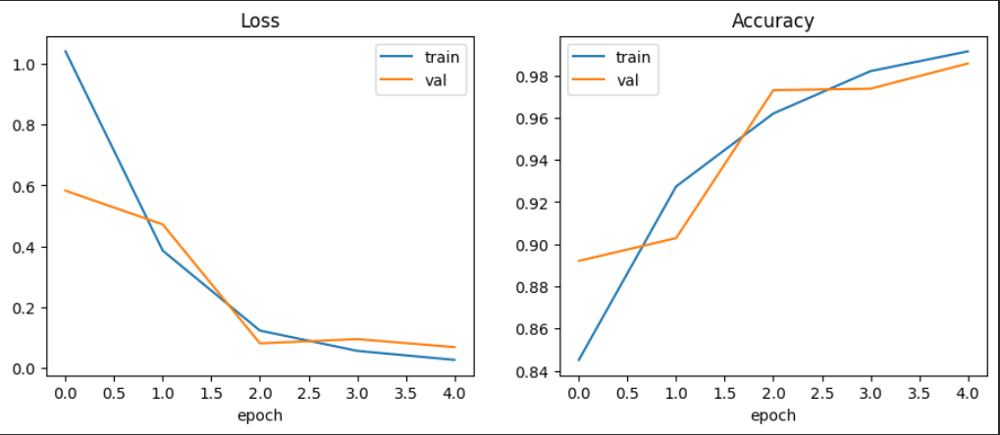
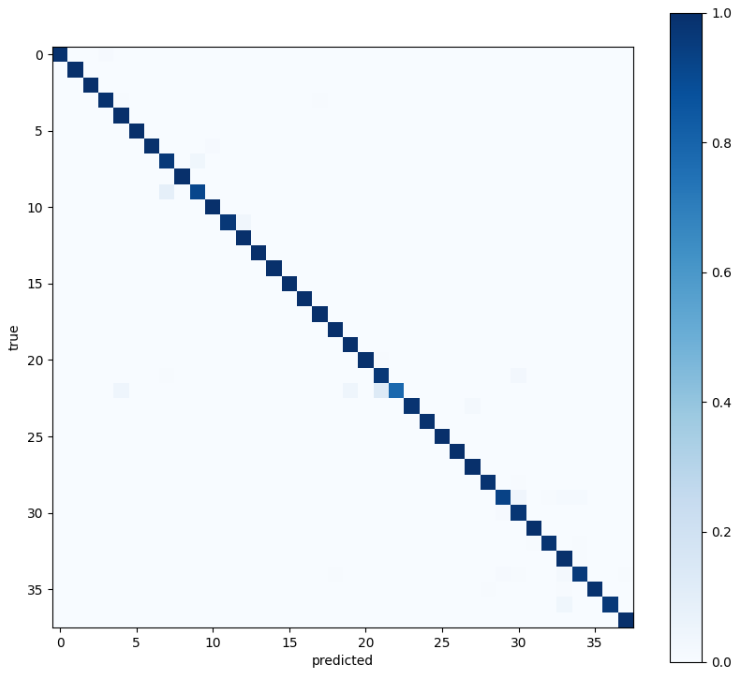

# LeafLens

Plant disease classification on the PlantVillage dataset using transfer learning (ResNet-50, PyTorch), with Grad-CAM explainability and a real-world robustness check on PlantDoc field photos.

## Status

| Stage | State |
|---|---|
| 1. Data setup and preprocessing | Done |
| 2. ResNet-50 model and training | Done |
| 3. Evaluation (per-class F1, confusion matrix) | Done |
| 4. Explainability (Grad-CAM) | Done |
| 5. Real-world check (PlantDoc field images) | Done |
| 6. LLM explanation layer | Planned |
| 7. Web app and deployment | Planned |

## Results (PlantVillage test set, 8,146 images)

| Metric | Value |
|---|---|
| Test accuracy | 98.83% |
| Macro-F1 | 0.9825 |
| Best validation accuracy | 98.56% |

- Training only the new classifier head reached 90.29% validation accuracy. Fine-tuning the last ResNet block (`layer4`) raised it to 98.56%.
- Lowest per-class F1: Potato healthy 0.878 (only 23 test images), Corn Cercospora/Gray leaf spot 0.897 (precision 0.841), Corn Northern Leaf Blight 0.944, Tomato Early blight 0.946.

*Row-normalized confusion matrix. Axes are class indices in alphabetical order of the PlantVillage folder names.*

These numbers come from the same distribution as the training data (lab images, image-level split), so they overestimate field performance: on PlantDoc field photos the same model scores 22.9% top-1 (see below).

## Real-world check (PlantDoc)

PlantDoc is a labeled set of field photos with natural backgrounds. I mapped its 27 test classes onto the matching PlantVillage classes and ran the trained model, unchanged, on all 236 PlantDoc test images.

| Metric | PlantVillage test | PlantDoc test |
|---|---|---|
| Top-1 accuracy | 98.83% | 22.9% |
| Top-3 accuracy | not measured | 45.3% |

With 236 images, the interval around 22.9% is roughly plus or minus 5 points (normal approximation).

**Per-class highlights (n per class is only 4 to 12, so these are noisy):**
- Best: grape black rot 75% (n=8), bell pepper healthy 62.5% (n=8), blueberry healthy 54.5% (n=11).
- All five healthy-leaf classes I could check (Apple, Peach, Tomato, Strawberry, Soybean) scored 0%.
- Also 0%: Potato late blight, Tomato mosaic virus, Tomato bacterial spot, Tomato leaf mold.

**Confidence does not fix it.** Filtering by softmax confidence discards most images but barely improves accuracy on what is kept:

| Confidence threshold | Share of images kept | Top-1 accuracy on kept |
|---|---|---|
| 0.5 | 39.0% | 35.9% |
| 0.7 | 14.8% | 37.1% |
| 0.9 | 5.5% | 38.5% |

So softmax confidence is not a reliable "I don't know" signal under this domain shift.

**A qualitative look at 4 random images with Grad-CAM heatmaps:**

| PlantDoc label | Model top-1 | Confidence | Correct |
|---|---|---|---|
| Corn rust | Corn Northern Leaf Blight | 43.6% | No |
| Apple rust | Potato Late blight | 46.3% | No |
| Tomato Early blight | Tomato Early blight | 60.9% | Yes |
| Raspberry leaf | Strawberry Leaf scorch | 87.5% | No |

- In three of the four examples the Grad-CAM highlight sat on the background, an image edge, or a fruit rather than on the lesion, which suggests the model partly relies on cues from PlantVillage's plain backgrounds. This is a small sample.

**Caveats:**
- Some class mappings are approximate (for example PlantDoc "Bell_pepper leaf spot" mapped to bacterial spot, "Corn leaf blight" to Northern Leaf Blight, "Corn rust" to Common rust).
- PlantDoc images are scraped from the web, so some labels may be noisy.
- PlantDoc images are not included in this repo.

## Model and training

- ImageNet-pretrained ResNet-50 (torchvision `IMAGENET1K_V2` weights), final layer replaced with 38 outputs.
- Phase 1: train only the new head, 2 epochs, Adam, lr 1e-3.
- Phase 2: train `layer4` and the head, 3 epochs, Adam, lr 1e-4.
- Cosine learning-rate schedule within each phase, batch size 64, mixed precision (fp16), BatchNorm layers kept in eval mode.
- Class-weighted cross-entropy loss to offset the class imbalance.
- Checkpoint chosen by validation accuracy; test set used once at the end.
- About 18 minutes total on a Colab T4 GPU.

## Explainability

Grad-CAM on the last ResNet block (`layer4[-1]`), implemented with forward hooks and no extra libraries. It shows where the model looked for its prediction. It is a coarse (7x7) attribution method, not proof of what the model understands.

## Data pipeline

- **Dataset:** PlantVillage (color images), 38 classes, 54,305 images. Class sizes range from 152 (Potato healthy) to 5,507 (Orange Huanglongbing), roughly a 36x gap.
- **Split:** stratified 70/15/15 (train/val/test) with a fixed seed, done before augmentation to prevent leakage. Sizes: 38,013 / 8,146 / 8,146.
- **Train transforms:** random resized crop (224), horizontal and vertical flips, rotation (20 degrees), color jitter.
- **Eval transforms:** resize 256, center crop 224.
- **Normalization:** ImageNet mean/std, matching the pretrained weights.
- **Checks:** no overlap between splits, every class present in every split, batch shape and normalization verified, augmented samples inspected visually.

## Known limitations

- PlantVillage images are single leaves on plain backgrounds, and performance does not carry over to field photos: 98.83% on PlantVillage versus 22.9% top-1 on PlantDoc.
- The split is by image, not by leaf. The dataset contains near-duplicate shots of the same leaf, which can inflate test scores.
- Several classes have few test images (for example 23 for Potato healthy), so their per-class numbers are noisy.
- The model has no "not a leaf" class and will confidently misclassify unrelated images.

## Files

| File | Contents |
|---|---|
| `LeafLens_01_data_preprocessing_output.ipynb` | Stage 1 only: data setup and preprocessing, with outputs |
| `LeafLens_full_pipeline.ipynb` | Stages 1-3: preprocessing, training, evaluation |
| `LeafLens_03_explainability.ipynb` | Stages 4-5: Grad-CAM and the PlantDoc check |
| `assets/` | Result figures used in this README |

Trained weights (`best.pt`, about 95 MB) are not stored in this repo.

## Run it

1. Open `LeafLens_full_pipeline.ipynb` in Google Colab and switch the runtime to GPU.
2. Provide a Kaggle API credential (`kaggle.json`) when prompted. Never commit this file.
3. Run all cells. Training takes roughly 20 minutes and produces `best.pt` and `splits.json`.
4. For explainability, open `LeafLens_03_explainability.ipynb` and upload `best.pt` and `splits.json` when asked.
